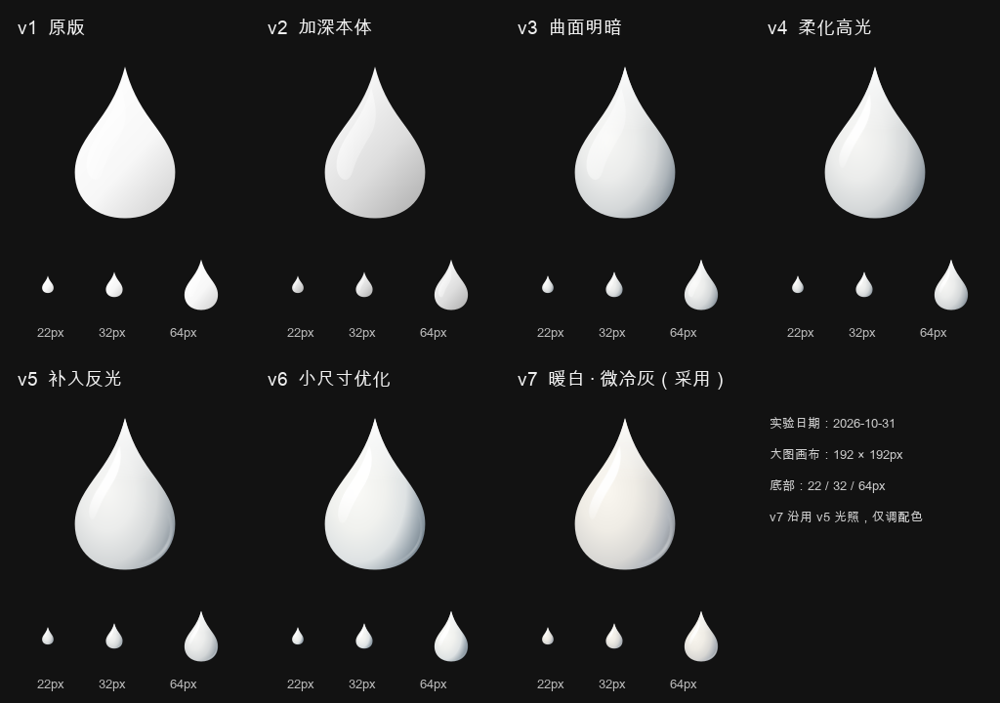

# 白色墨滴图标优化实验记录

日期：2026-10-31。

最终采用 **v7：略暖白主体、轻微冷灰暗部、中性白高光**，正式文件为
[`app-icon-white.svg`](../frontend/web/src/site/pages/assets/app-icon-white.svg)。
首页通过 [`welcome-page.tsx`](../frontend/web/src/site/pages/welcome-page.tsx) 按主题选择图标：暗色主题使用白色稿，浅色主题使用原有的 [`app-icon.svg`](../frontend/web/src/site/pages/assets/app-icon.svg)。

实验结束后删除临时对比页及各版本 SVG，只保留正式稿、本记录和 PNG 对照图。

## 1. 问题与目标

原白色图标的高光不明显；深色图标的月牙高光更容易辨认。第一轮将白色本体压灰后，高光略有改善，但用户仍认为墨滴缺乏立体感。

本次优化同时考虑三个目标：

- 保持原有墨滴轮廓、透明背景及白色识别度。
- 让腹部有圆润的体积，再用高光表现表面光泽。
- 在首页真实的 22px 品牌位仍能看出主要明暗，放大后过渡自然。

所有版本均使用 `viewBox="0 0 512 512"`，轮廓范围为 x=119–393、y=54–468。因此 22px 是图框尺寸，墨滴本身实际约 **11.8 × 17.8 CSS px**；不能仅凭放大图选择版本。

## 2. 原因分析与口径修正

### 高光存在，但与本体的局部对比很弱

原版白色本体为 `#FFFFFF → #F7F7F7 → #D8D8D8`，高光也是白色。较强的高光主要落在本体本来就很亮的区域，进一步加白的空间很小。

本体与高光均大致从左上向右下衰减，但两者的渐变坐标及覆盖范围不同，不能说是完全相同的梯度。早期“一次有效叠加都没发生”“3% 肉眼不可分辨”等表述过于绝对；实际仍有可见但较弱的色值变化。

深色版与原白色版的高光路径相同，**渐变参数并非逐字节相同**：

| 高光参数 | 深色版 | 原白色版 / v2 |
| --- | --- | --- |
| 起点不透明度 | 0.92 | 0.9 |
| 中间停止点 | offset 0.55，opacity 0.38 | offset 0.62，opacity 0.35 |
| 终点不透明度 | 0.02 | 0.04 |

原白色版与 v2 的高光则确实相同。高光在深色底上更明显这一判断成立，但没有必要把“高光必须一字不改”当作后续设计约束。

### 高光可见不等于曲面有体积

v2 保留了斜向线性渐变。它提供明暗方向，却没有充分表达腹部鼓起及侧面转折；边界清晰的月牙也容易读成附着在表面的色块。

后续因此改为：偏心椭圆明暗塑造体积，收窄并柔化的主高光表达光泽，弱边缘反光补充曲面转折。分析阶段另做过去掉高光的示意，确认本体自身也应能呈现圆润感。

## 3. 逐版实验

v1–v6 按顺序累加调整；**v7 是基于 v5 的配色分支，不继承 v6 的小尺寸强化**。

| 版本 | 基准 | 具体变化 | 观察与决策 |
| --- | --- | --- | --- |
| v1 | 原白色稿 | 白到浅灰的线性渐变，原月牙高光 | 白色识别明确，高光和体积较弱。 |
| v2 | v1 | 本体 offset 0.62 从 `#F7F7F7` 改为 `#DDDDDD`，终点从 `#D8D8D8` 改为 `#B8B8B8`，高光不变 | 高光更可见；用户反馈改善有限，立体感仍不明显。 |
| v3 | v2 | 用偏心椭圆径向渐变塑造腹部及右侧阴影，增加尖端亮度过渡；保留原月牙高光 | 本体有了曲面明暗，原高光的色块感仍可比较。 |
| v4 | v3 | 高光收窄、弯曲、末端渐隐，边缘轻微模糊 | 高光更贴合表面，过渡更柔和。 |
| v5 | v4 | 在右下暗部增加一小段弱反光 | 表面转折更完整，形成较细腻的光泽。 |
| v6 | v5 | 加强明暗分区，加宽并延长主高光，降低模糊，减弱边缘细节 | 作为 22/32px 的光学强化候选；对比中明暗更鲜明，未最终采用。 |
| v7 | v5 | 仅调整配色：主体略暖、暗部低饱和冷灰、主高光仍为中性白 | 用户明确选择采用，并要求替换正式白色图标。 |

以下 PNG 在删除实验 SVG 前由各版本直接渲染保存。大图画布为 192px，下方为 22/32/64px；整张图片在文档中被缩放时，小图不再对应屏幕上的实际 CSS 尺寸。

## 4. 对照方法与像素数据的边界

临时 `#/icon-demo` 页展示了全部版本的 22/32/64/128px 图标、22px 首页品牌条、两版自由选择和深色版参考。白色稿统一放在固定深色观察底 `hsl(0 0% 7%)`，避免页面主题改变对照条件；深色稿放在浅色底上。

归档时重新固定采样条件：使用 `rsvg-convert` 渲染为 512×512 RGBA PNG，在像素 `(174, 300)` 与 `(300, 300)` 采样。两个位置均完全不透明。

| 版本 | 左侧高光区域 `(174, 300)` | 同高右侧本体 `(300, 300)` | 灰阶数值差 / 255 |
| --- | --- | --- | --- |
| v1 | `#FCFCFC` | `#F4F4F4` | 8 / 255 ≈ 3.14% |
| v2 | `#F3F3F3` | `#DADADA` | 25 / 255 ≈ 9.80% |

早期记录中的 v2“10.6%”来自另一组未完整保留采样坐标的记录，本记录不将其当作可复现的验收值。上表的百分比只是 **sRGB 编码灰阶差的归一化数值**，不是线性相对亮度、对比度比值或立体感评分。

此外，不同位置的色差同时包含本体渐变和高光的影响，不能单独证明高光层的贡献。若要隔离高光，应在同一位置比较“开启高光”和“关闭高光”的渲染；v7 含有色温差异，更不能用单通道灰阶差评价材质优劣。

实际选择以三项观察为主：隐藏高光时本体是否仍圆润、22px 下主要明暗是否可辨、正常观看时是否仍首先读作白色墨滴。

## 5. 最终稿的结构与参数

正式 SVG 是当前实现的权威来源。以下参数记录本次采用状态，后续调整时应结合源码核对。

### 本体与配色

主径向渐变使用 `gradientUnits="userSpaceOnUse"`，中心 `(208,252)`，半径 `290`，通过 `translate(208 252) scale(.76 1.12) translate(-208 -252)` 形成椭圆光照。

| offset | v3–v5 配色 | v7 正式配色 | 作用 |
| --- | --- | --- | --- |
| 0 | `#F7F7F5` | `#FAF7F0` | 腹部亮区，略暖白 |
| 0.34 | `#EBECEB` | `#EFECE5` | 主体暖白过渡 |
| 0.61 | `#D4D7D8` | `#D8D7D4` | 接近中性的过渡灰 |
| 0.79 | `#ADB4B9` | `#AFB4BA` | 轻微冷灰暗部 |
| 1 | `#687581` | `#6F747A` | 低饱和冷灰的深部 |

尖端亮度层从 `(256,65)` 到 `(256,228)` 衰减；起点为 `#FFFEFA`、opacity 0.95，终点透明。v5 对应起点为纯白，其余结构相同。

### 主高光与弱反光

| 层 | 正式参数 |
| --- | --- |
| 主高光渐变 | `(204,158) → (195,353)`，纯白；offset 0 / 0.50 / 1 对应 opacity 0.98 / 0.86 / 0 |
| 主高光路径 | 收窄的左侧弧形，采用 v4/v5 形状；精确曲线见正式 SVG |
| 主高光柔化 | `feGaussianBlur stdDeviation="2.3"` |
| 右下反光路径 | `M375 315 C402 385 355 445 285 457`，圆端，stroke-width 8 |
| 右下反光渐变 | `(379,313) → (286,457)`，首尾透明；中点 `#F3F5F5`、opacity 0.46 |
| 右下反光柔化 | `feGaussianBlur stdDeviation="3"` |
| 裁切与背景 | 所有图层限制在原墨滴轮廓内，画布背景透明 |

模糊参数以 512 单位画布为基准，不能直接理解为展示尺寸中的 CSS 像素。滤镜使用 `color-interpolation-filters="sRGB"`，高光与反光都只做局部柔化。

### v6 候选的差异，供以后小尺寸优化参考

- 本体停止点为 0 / 0.34 / 0.60 / 0.78 / 1，对应 `#FAFAF7 / #F0F1EE / #DEE2E3 / #A0ABB3 / #5B6B78`。
- 主高光重新加宽、延长；渐变终点 y=367，中点 opacity=0.92，模糊降为 1.2。
- 右下反光 stroke-width=6，中点 opacity=0.26，模糊降为 1.4。
- 这些强化没有合入正式稿；后续若再优化小尺寸，应作为独立变量重新对照。

## 6. 采用、验证与清理

采用过程：先将首页引用切到 v7，再将其扶正为 `app-icon-white.svg`。内部 ID 改用 `ink-white-` 前缀，去除实验版本元信息；改名前后 128px RGBA 渲染逐像素一致。

实验期间完成的验证包括：

- SVG 的 22/32/64px 及放大渲染检查。
- v1–v6 对比页的版本切换、暗/浅主题、桌面多列及窄屏布局检查。
- v7 的配色差异检查，确认相对 v5 仅改变颜色及元信息，轮廓、光照位置、滤镜参数相同。
- 正式文件路径的开发服务器访问、TypeScript/生产构建、lint 及现有 6 项测试。

验证范围是本地渲染与开发页面；没有据此宣称已完成实体移动设备或已发布桌面客户端的专项视觉复核。生产构建存在依赖样式的 `@theme` 提示及包体积提示，未阻断构建。

归档清理内容：

- 删除临时对比页 `icon-demo-page.tsx`、`icon-demo-page.css` 以及 `App.tsx` 中的 import 和专用分支；不再维护 `#/icon-demo` 入口。
- 删除 `app-icon-white-v1.svg` 至 `app-icon-white-v6.svg`；v7 文件此前已改为正式文件名。
- 保留正式白色稿 `app-icon-white.svg` 和原有深色稿 `app-icon.svg`。
- 实验稿未逐版提交，后续参考本记录的参数和 PNG 对照。原始白色稿可从本次正式替换提交的父提交中找到。

后续调整优先保持单一变量：先比较曲面明暗，再比较高光、边缘反光和色温。最终仍以真实品牌位的观感选择，不把更深的阴影、更亮的高光或更大的像素差当作自动更优。
